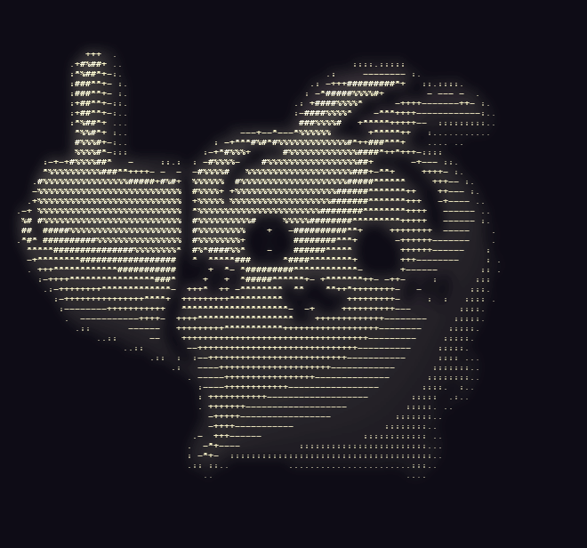

# ascii-3d

이미지를 말랑한 입체로 부풀려서, 색 있는 아스키 글자로 빙글빙글 돌려 보는 3D 아스키 메이커예요.



**바로 써보기 → https://seoyeon1123.github.io/ascii-3d/**

## 할 수 있는 것

- **내 이미지로 바로 만들기**: 화면 아래 **이미지 올리기**를 누르거나, 아무 데나 끌어다 놓거나, `⌘V`로 붙여넣으면 배경 지우기 → 입체로 부풀리기 → 아스키로 그리기까지 자동으로 끝나요. 투명 배경 PNG가 가장 깔끔하고, 배경이 있는 사진은 가장자리 색을 기준으로 지워요.
- **손가락·귀 움직이기**: 토끼는 손가락이 **까딱까딱**, 두 귀가 **팔랑팔랑** 움직여요. 부위마다 까딱까딱 · 좌우 흔들기 · 팔랑팔랑 중에서 고를 수 있고, **+ 부위 추가**를 누르고 화면에서 뿌리 → 끝으로 드래그하면 팔·꼬리처럼 다른 부위도 움직여요. GIF·MP4에도 움직임이 끊김 없이 반복되게 녹화돼요.
- **옆모습 그림 반영(실험, 기본은 꺼짐)**: 옆모습 섹션에서 켜면 옆으로 돌 때 같은 캐릭터를 옆에서 그린 그림(얼굴이 왼쪽)이 보이고 몸 두께도 그 그림에 맞춰져요. **옆모습 이미지 올리기**로 다른 그림을 넣을 수도 있어요.
- **바로 다운로드**: **GIF**(640px, 60프레임)와 **MP4**(1080×1080, 30fps, H.264) 버튼 한 번이면 지금 각도·글자·색 그대로 한 바퀴를 저장해요. 둘 다 브라우저 안에서 만들어서 서버로 보내는 건 없어요.
- **돌려보기**: 끌어서 회전, 휠·핀치로 확대, 더블클릭으로 처음 각도. 키보드는 `← → ↑ ↓`, `+ -`, `space`(자동 회전)
- **글자셋**: 클래식 `.:-=+*#%@` · 디테일(70자) · 블록 `░▒▓█` · 점자 `⣿` · 바이너리 `.10`
- **색**: 원본 컬러 · 흑백 · 매트릭스 · 앰버 / **배경**: 다크(빛나는 글자) · 페이퍼(연필 스케치)
- **모양**: 볼륨(납작한 스티커 ↔ 빵빵한 풍선), 글자 크기, 조명 방향, 윤곽선, 글로우
- **그 밖에**: 지금 화면을 텍스트로 복사, PNG로 저장

## 터미널에서 돌리기

```bash
pip install numpy pillow
python3 ascii3d_terminal.py               # 내장된 토끼
python3 ascii3d_terminal.py 내사진.png     # 다른 이미지
python3 ascii3d_terminal.py --once        # 한 프레임만 출력하고 끝내기
python3 ascii3d_terminal.py --light       # 밝은 배경 터미널용
```

| 키 | 동작 |
| --- | --- |
| `← → ↑ ↓` / `WASD` | 돌리기 |
| `+` `-` | 확대·축소 |
| `space` | 자동 회전 켜기/끄기 |
| `c` | 색 바꾸기 |
| `g` | 글자셋 바꾸기 |
| `v` `V` | 볼륨 줄이기·키우기 |
| `e` | 윤곽선 켜기/끄기 |
| `q` | 종료 |

트루컬러를 지원하는 터미널(iTerm2 등)에서 가장 예쁘게 나와요. macOS 기본 터미널에서는 자동으로 256색으로 바뀌어요.

## 어떻게 3D가 되나요

1. **실루엣**: 알파 채널로 모양을 따요. 투명 배경이 없으면 테두리 색에서 시작하는 flood-fill로 배경을 지워요.
2. **부풀리기**: 실루엣 안에서 포아송 방정식 `∇²u = −1`을 풀고(coarse-to-fine SOR) 높이를 `z = 2√u`로 잡아요. 동그란 몸통은 반구처럼, 가늘고 긴 손가락은 원기둥처럼 부풀어요.
3. **점 구름**: 앞면과 뒷면을 만들고, 가파른 옆면은 점을 세로로 채워서 어느 각도에서도 구멍이 안 보이게 해요.
4. **렌더링**: 점을 z-버퍼에 찍고, 글자 한 칸마다 2×2 샘플을 모아 밝기로 글자를, 텍스처로 색을 골라요.
5. **얼굴 살리기**: 선화(검은 선)와 앞에 가린 윤곽은 빈칸으로 남겨서, 돌려도 눈·입이 또렷하게 보여요.
6. **움직이기**: 드래그한 뼈 주변에서 선화로 나뉜 부위만 골라내고(토끼 귀는 윤곽을 따로 지정), 뿌리 쪽은 가중치를 부드럽게 줘서 관절처럼 휘게 해요. 뿌리를 축으로 회전(로드리게스 공식)시켜서 까딱·흔들기·팔랑을 만들어요.
7. **옆모습 그림(켰을 때)**: 옆모습 그림의 실루엣으로 줄마다 앞·뒤 두께를 맞추고, 옆을 향한 면에만 그 그림을 입혀요.

웹은 이 과정을 브라우저에서 계산하고, 글자 그리기는 WebGL 셰이더 한 번으로 해요. `index.html` 한 파일로 돌아가요. GIF는 직접 짠 인코더(median-cut 팔레트 + LZW)로 만들고, MP4는 버튼을 누를 때만 [Mediabunny](https://github.com/Vanilagy/mediabunny)(MPL-2.0)를 jsDelivr에서 불러와 WebCodecs로 인코딩해요.

## 파일

| 파일 | 설명 |
| --- | --- |
| `index.html` | 웹 툴 (단일 파일) |
| `ascii3d_terminal.py` | 터미널 버전 (numpy, pillow) |
| `assets/demo.gif` | 데모 GIF |

## 라이선스

코드는 [MIT](LICENSE)예요. 예시로 들어 있는 토끼 이미지(앞모습·옆모습)는 MIT 라이선스에 포함되지 않으며, 저작권은 원작자에게 있어요.
